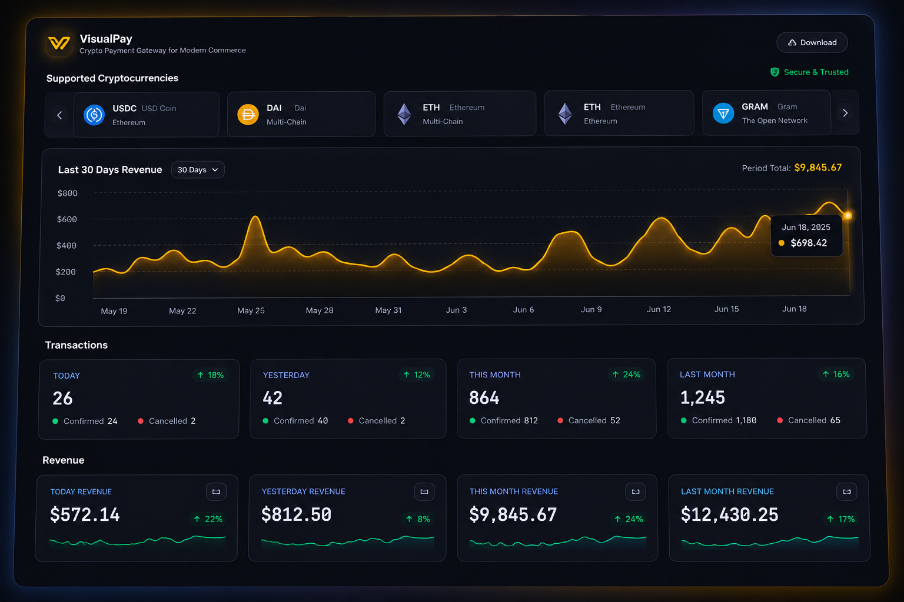
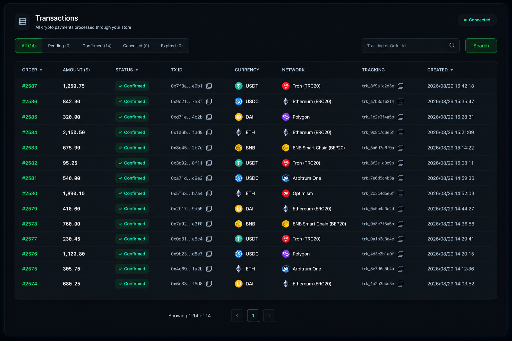
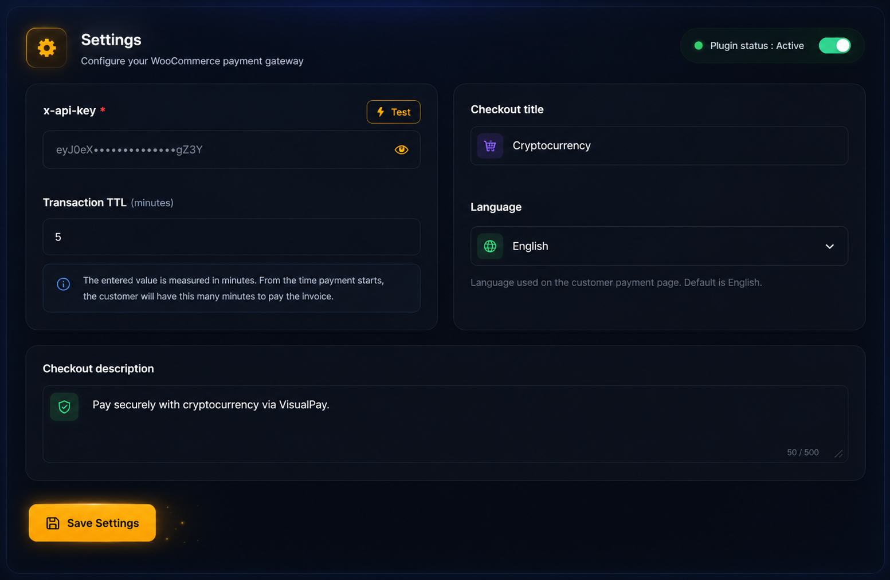

# VisualPay for WooCommerce

  

Accept cryptocurrency payments in WooCommerce via the [VisualPay Merchant API](https://visualpay.net).

**Plugin version:** 1.0.2

## Screenshots

| Overview | Transactions | Settings |
|:---:|:---:|:---:|
|  |  |  |

1. **Overview** — merchant dashboard with revenue chart, cards, and supported coins  
2. **Transactions** — local list with status filters and search  
3. **Settings** — gateway, API key test, TTL, checkout labels, and payment page language  

---

## Languages / 语言 / Idiomas

Payment page UI languages supported by this plugin. Documentation below is provided in each language.

- [English](#english)
- [中文 (Chinese)](#中文-chinese)
- [Español (Spanish)](#español-spanish)
- [العربية (Arabic)](#العربية-arabic)
- [Bahasa Indonesia](#bahasa-indonesia)
- [Português (Portuguese)](#português-portuguese)
- [Français (French)](#français-french)
- [日本語 (Japanese)](#日本語-japanese)
- [Русский (Russian)](#русский-russian)
- [Deutsch (German)](#deutsch-german)

> The **Language** setting under **VisualPay → Settings** changes only the customer payment page. WordPress admin screens stay in English.

---

## English

### Features

- Cryptocurrency checkout gateway for WooCommerce
- Secure payment page with QR code and wallet address copy
- Server-side amount lock (`amount_usd`) — customers cannot change the charge amount
- Live status polling (awaiting / confirmed / expired / cancelled)
- Cancel payment from the payment modal
- Transaction TTL (5–60 minutes, configurable)
- Admin **Overview** dashboard (revenue chart, cards, API status, supported coins)
- Admin **Transactions** list (filters, search by `tx_id` / order, order modal)
- Admin **Settings** (enable gateway, API key test, TTL, checkout title/description, language)
- API key never leaves the server; the payment page uses WordPress AJAX only
- Local transaction store (`wp_visualpay_transactions`)

### Requirements

- WordPress 6.0+
- WooCommerce 7.0+
- PHP 7.4+
- VisualPay merchant `x-api-key` (<a href="https://visualpay.net/signup" target="_blank" rel="noopener noreferrer">Create free Merchant</a>)

### Installation

1. Download the latest plugin ZIP from the repository **Releases** section
2. In WordPress admin go to **Plugins → Add New → Upload Plugin**, choose the ZIP file, then click **Install Now**
3. Activate **VisualPay for WooCommerce**
4. Open **VisualPay → Settings** and configure the options below
5. Go to **Settings → Permalinks** and click **Save** once (flushes rewrite rules for `/visualpay/`)

### Setup

1. Turn the gateway **Active** (status switch on Settings)
2. Paste your merchant **x-api-key** and optionally click **Test**
3. Set **Transaction TTL** (minutes the customer has to pay; default 15)
4. Set **Checkout title** and **Description** (shown at WooCommerce checkout)
5. Choose **Language** for the customer payment UI
6. Click **Save Settings**

### Checkout flow

1. Customer selects the cryptocurrency method at checkout and places the order
2. They are redirected to `/visualpay/?order_id=…&key=…`
3. Amount is locked from the WooCommerce order total (sent as `amount_usd`)
4. Customer picks coin + network and clicks **Pay Now**
5. They pay the **`pay_amount`** shown (exact crypto amount) via QR or wallet address
6. The plugin polls status; on `confirmed` the order is marked paid (`payment_complete`)

### Admin menus

- **Overview** — 30-day revenue chart, transaction/revenue cards, cryptocurrencies, API connection
- **Transactions** — local list with status filters and search
- **Settings** — gateway, API key, TTL, language, checkout labels

### Notes

- Store totals are treated as USD for `amount_usd`
- Charge amount and metadata are set on the server only

---

## 中文 (Chinese)

### 功能

- WooCommerce 加密货币支付网关
- 带二维码与钱包地址复制的安全支付页
- 服务端锁定金额（`amount_usd`），买家无法篡改
- 实时状态轮询（等待 / 已确认 / 已过期 / 已取消）
- 可在支付弹窗中取消付款
- 交易有效期 TTL（5–60 分钟，可配置）
- 后台 **Overview** 概览（收入图表、卡片、API 状态、支持币种）
- 后台 **Transactions** 交易列表（筛选、按 `tx_id` / 订单搜索）
- 后台 **Settings**（启用网关、测试 API Key、TTL、结账标题/说明、语言）
- API Key 仅保存在服务器；支付页只通过 WordPress AJAX 通信
- 本地交易表（`wp_visualpay_transactions`）

### 系统要求

- WordPress 6.0+
- WooCommerce 7.0+
- PHP 7.4+
- VisualPay 商户 `x-api-key`（<a href="https://visualpay.net/signup" target="_blank" rel="noopener noreferrer">免费创建商户</a>）

### 安装

1. 从仓库的 **Releases** 区域下载最新的插件 ZIP 文件
2. 在 WordPress 后台进入 **插件 → 安装插件 → 上传插件**，选择 ZIP 文件后点击 **现在安装**
3. 启用 **VisualPay for WooCommerce**
4. 打开 **VisualPay → Settings** 进行配置
5. 进入 **设置 → 固定链接**，点击一次 **保存**（刷新 `/visualpay/` 重写规则）

### 配置

1. 将网关状态设为 **Active**
2. 粘贴商户 **x-api-key**，可点击 **Test** 测试
3. 设置 **Transaction TTL**（买家付款时限，默认 15 分钟）
4. 设置结账 **标题** 与 **说明**
5. 选择支付页 **Language**
6. 点击 **Save Settings**

### 结账流程

1. 买家在结账页选择加密货币并提交订单
2. 跳转到 `/visualpay/?order_id=…&key=…`
3. 金额按 WooCommerce 订单总额锁定（`amount_usd`）
4. 选择币种与网络后点击 **Pay Now**
5. 按页面显示的 **`pay_amount`** 通过二维码或地址付款
6. 插件轮询状态；`confirmed` 后订单标记为已付款

### 后台菜单

- **Overview** — 收入图表、统计卡片、币种与 API 状态
- **Transactions** — 本地交易列表与筛选搜索
- **Settings** — 网关、密钥、TTL、语言与结账文案

### 说明

- 店铺金额按 USD 作为 `amount_usd` 处理
- 金额与元数据仅由服务器设置

---

## Español (Spanish)

### Funciones

- Pasarela de pago con criptomonedas para WooCommerce
- Página de pago segura con código QR y copia de dirección de monedero
- Bloqueo del importe en el servidor (`amount_usd`) — el cliente no puede modificarlo
- Sondeo de estado en vivo (pendiente / confirmado / expirado / cancelado)
- Cancelación desde el modal de pago
- TTL de transacción (5–60 minutos, configurable)
- Panel **Overview** (gráfico de ingresos, tarjetas, estado de API, monedas)
- Lista **Transactions** (filtros, búsqueda por `tx_id` / pedido)
- **Settings** (activar pasarela, probar API key, TTL, título/descripción, idioma)
- La API key no sale del servidor; la página de pago solo usa AJAX de WordPress
- Almacén local de transacciones (`wp_visualpay_transactions`)

### Requisitos

- WordPress 6.0+
- WooCommerce 7.0+
- PHP 7.4+
- `x-api-key` de comerciante VisualPay (<a href="https://visualpay.net/signup" target="_blank" rel="noopener noreferrer">Crear Merchant gratis</a>)

### Instalación

1. Descargue el ZIP más reciente del plugin desde la sección **Releases** del repositorio
2. En el administrador de WordPress vaya a **Plugins → Añadir nuevo → Subir plugin**, elija el ZIP y pulse **Instalar ahora**
3. Active **VisualPay for WooCommerce**
4. Abra **VisualPay → Settings** y configure las opciones
5. Vaya a **Ajustes → Enlaces permanentes** y pulse **Guardar** una vez (reglas de `/visualpay/`)

### Configuración

1. Ponga la pasarela en **Active**
2. Pegue su **x-api-key** y, si quiere, pulse **Test**
3. Defina el **Transaction TTL** (minutos para pagar; predeterminado 15)
4. Defina el **título** y la **descripción** del checkout
5. Elija el **Language** de la página de pago
6. Pulse **Save Settings**

### Flujo de pago

1. El cliente elige criptomoneda en el checkout y realiza el pedido
2. Se redirige a `/visualpay/?order_id=…&key=…`
3. El importe se bloquea desde el total del pedido (`amount_usd`)
4. Elige moneda + red y pulsa **Pay Now**
5. Paga el **`pay_amount`** mostrado (importe exacto en cripto)
6. El plugin consulta el estado; con `confirmed` el pedido se marca como pagado

### Menús de administración

- **Overview** — gráfico, tarjetas, monedas y estado de API
- **Transactions** — lista local con filtros y búsqueda
- **Settings** — pasarela, clave, TTL, idioma y textos

### Notas

- Los totales de la tienda se tratan como USD para `amount_usd`
- Importe y metadatos solo se definen en el servidor

---

## العربية (Arabic)

> واجهة صفحة الدفع تدعم العربية (RTL). شاشات إدارة ووردبريس تبقى بالإنجليزية.

### المزايا

- بوابة دفع بالعملات المشفرة لـ WooCommerce
- صفحة دفع آمنة مع رمز QR ونسخ عنوان المحفظة
- قفل المبلغ من الخادم (`amount_usd`) — لا يمكن للعميل تغييره
- تحديث حالة الدفع تلقائيًا (قيد الانتظار / مؤكد / منتهي / ملغى)
- إلغاء الدفع من نافذة الدفع
- مدة صلاحية المعاملة TTL (5–60 دقيقة، قابلة للتعديل)
- لوحة **Overview** (رسم الإيرادات، البطاقات، حالة API، العملات)
- قائمة **Transactions** (تصفية وبحث بـ `tx_id` / الطلب)
- **Settings** (تفعيل البوابة، اختبار المفتاح، TTL، عنوان/وصف الدفع، اللغة)
- مفتاح API لا يغادر الخادم؛ صفحة الدفع تستخدم فقط AJAX في ووردبريس
- تخزين محلي للمعاملات (`wp_visualpay_transactions`)

### المتطلبات

- WordPress 6.0+
- WooCommerce 7.0+
- PHP 7.4+
- مفتاح التاجر VisualPay: `x-api-key` (<a href="https://visualpay.net/signup" target="_blank" rel="noopener noreferrer">إنشاء حساب تاجر مجانًا</a>)

### التثبيت

1. حمّل أحدث ملف ZIP للإضافة من قسم **Releases** في المستودع
2. من لوحة ووردبريس اذهب إلى **إضافات → أضف جديدًا → رفع إضافة**، اختر ملف ZIP ثم اضغط **التنصيب الآن**
3. فعّل **VisualPay for WooCommerce**
4. افتح **VisualPay → Settings** واضبط الإعدادات
5. اذهب إلى **الإعدادات → الروابط الدائمة** واضغط **حفظ** مرة واحدة (لقواعد `/visualpay/`)

### الإعداد

1. اجعل حالة البوابة **Active**
2. الصق **x-api-key** ويمكنك الضغط على **Test**
3. عيّن **Transaction TTL** (دقائق للدفع؛ الافتراضي 15)
4. عيّن عنوان ووصف صفحة الدفع في المتجر
5. اختر **Language** لواجهة صفحة الدفع
6. اضغط **Save Settings**

### مسار الدفع

1. يختار العميل العملة المشفرة عند الدفع ويُكمل الطلب
2. يُعاد توجيهه إلى `/visualpay/?order_id=…&key=…`
3. يُقفل المبلغ من إجمالي طلب WooCommerce (`amount_usd`)
4. يختار العملة والشبكة ثم **Pay Now**
5. يدفع قيمة **`pay_amount`** المعروضة عبر QR أو عنوان المحفظة
6. يتحقق المكوّن الإضافي من الحالة؛ عند `confirmed` يُعلَّم الطلب كمدفوع

### قوائم الإدارة

- **Overview** — الرسم البياني والبطاقات والعملات وحالة API
- **Transactions** — قائمة محلية مع تصفية وبحث
- **Settings** — البوابة والمفتاح وTTL واللغة والنصوص

### ملاحظات

- تُعامل مبالغ المتجر كـ USD لـ `amount_usd`
- المبلغ والبيانات الوصفية تُضبط من الخادم فقط

---

## Bahasa Indonesia

### Fitur

- Gateway pembayaran cryptocurrency untuk WooCommerce
- Halaman pembayaran aman dengan QR code dan salin alamat wallet
- Jumlah dikunci di server (`amount_usd`) — pelanggan tidak bisa mengubahnya
- Polling status langsung (menunggu / dikonfirmasi / kedaluwarsa / dibatalkan)
- Batalkan pembayaran dari modal
- TTL transaksi (5–60 menit, dapat dikonfigurasi)
- Dasbor **Overview** (grafik pendapatan, kartu, status API, koin)
- Daftar **Transactions** (filter, cari `tx_id` / pesanan)
- **Settings** (aktifkan gateway, uji API key, TTL, judul/deskripsi, bahasa)
- API key tidak pernah keluar dari server; halaman bayar hanya memakai AJAX WordPress
- Penyimpanan transaksi lokal (`wp_visualpay_transactions`)

### Persyaratan

- WordPress 6.0+
- WooCommerce 7.0+
- PHP 7.4+
- `x-api-key` merchant VisualPay (<a href="https://visualpay.net/signup" target="_blank" rel="noopener noreferrer">Buat Merchant gratis</a>)

### Instalasi

1. Unduh ZIP plugin terbaru dari bagian **Releases** di repositori
2. Di admin WordPress buka **Plugin → Tambah Baru → Unggah Plugin**, pilih file ZIP, lalu klik **Pasang Sekarang**
3. Aktifkan **VisualPay for WooCommerce**
4. Buka **VisualPay → Settings** dan atur opsi
5. Buka **Pengaturan → Permalink** lalu klik **Simpan** sekali (flush aturan `/visualpay/`)

### Pengaturan

1. Setel gateway ke **Active**
2. Tempel **x-api-key** dan opsional klik **Test**
3. Atur **Transaction TTL** (menit untuk membayar; default 15)
4. Atur judul dan deskripsi checkout
5. Pilih **Language** untuk UI halaman pembayaran
6. Klik **Save Settings**

### Alur checkout

1. Pelanggan memilih kripto di checkout dan membuat pesanan
2. Dialihkan ke `/visualpay/?order_id=…&key=…`
3. Jumlah dikunci dari total pesanan WooCommerce (`amount_usd`)
4. Pilih koin + jaringan lalu **Pay Now**
5. Bayar **`pay_amount`** yang ditampilkan via QR atau alamat wallet
6. Plugin memantau status; saat `confirmed` pesanan ditandai lunas

### Menu admin

- **Overview** — grafik, kartu, koin, status API
- **Transactions** — daftar lokal dengan filter dan pencarian
- **Settings** — gateway, kunci, TTL, bahasa, label checkout

### Catatan

- Total toko diperlakukan sebagai USD untuk `amount_usd`
- Jumlah dan metadata hanya diset di server

---

## Português (Portuguese)

### Recursos

- Gateway de pagamento em criptomoedas para WooCommerce
- Página de pagamento segura com QR code e cópia do endereço da carteira
- Valor bloqueado no servidor (`amount_usd`) — o cliente não pode alterá-lo
- Polling de status em tempo real (aguardando / confirmado / expirado / cancelado)
- Cancelamento no modal de pagamento
- TTL da transação (5–60 minutos, configurável)
- Painel **Overview** (gráfico de receita, cartões, status da API, moedas)
- Lista **Transactions** (filtros, busca por `tx_id` / pedido)
- **Settings** (ativar gateway, testar API key, TTL, título/descrição, idioma)
- A API key não sai do servidor; a página de pagamento usa apenas AJAX do WordPress
- Armazenamento local de transações (`wp_visualpay_transactions`)

### Requisitos

- WordPress 6.0+
- WooCommerce 7.0+
- PHP 7.4+
- `x-api-key` do merchant VisualPay (<a href="https://visualpay.net/signup" target="_blank" rel="noopener noreferrer">Criar Merchant grátis</a>)

### Instalação

1. Baixe o ZIP mais recente do plugin na secção **Releases** do repositório
2. No admin do WordPress vá a **Plugins → Adicionar novo → Carregar plugin**, escolha o ZIP e clique em **Instalar agora**
3. Ative **VisualPay for WooCommerce**
4. Abra **VisualPay → Settings** e configure
5. Vá em **Definições → Links permanentes** e clique em **Guardar** uma vez (regras de `/visualpay/`)

### Configuração

1. Defina o gateway como **Active**
2. Cole o **x-api-key** e, opcionalmente, clique em **Test**
3. Defina o **Transaction TTL** (minutos para pagar; padrão 15)
4. Defina o título e a descrição do checkout
5. Escolha o **Language** da página de pagamento
6. Clique em **Save Settings**

### Fluxo de checkout

1. O cliente escolhe criptomoeda no checkout e finaliza o pedido
2. É redirecionado para `/visualpay/?order_id=…&key=…`
3. O valor é bloqueado a partir do total do pedido (`amount_usd`)
4. Escolhe moeda + rede e clica em **Pay Now**
5. Paga o **`pay_amount`** exibido via QR ou endereço da carteira
6. O plugin consulta o status; em `confirmed` o pedido é marcado como pago

### Menus de administração

- **Overview** — gráfico, cartões, moedas e status da API
- **Transactions** — lista local com filtros e pesquisa
- **Settings** — gateway, chave, TTL, idioma e textos

### Notas

- Totais da loja são tratados como USD para `amount_usd`
- Valor e metadados são definidos apenas no servidor

---

## Français (French)

### Fonctionnalités

- Passerelle de paiement crypto pour WooCommerce
- Page de paiement sécurisée avec QR code et copie d’adresse de portefeuille
- Montant verrouillé côté serveur (`amount_usd`) — le client ne peut pas le modifier
- Suivi du statut en direct (en attente / confirmé / expiré / annulé)
- Annulation depuis la modale de paiement
- TTL de transaction (5–60 minutes, configurable)
- Tableau **Overview** (graphique de revenus, cartes, statut API, cryptos)
- Liste **Transactions** (filtres, recherche `tx_id` / commande)
- **Settings** (activer la passerelle, tester la clé API, TTL, titre/description, langue)
- La clé API ne quitte jamais le serveur ; la page de paiement utilise uniquement l’AJAX WordPress
- Stockage local des transactions (`wp_visualpay_transactions`)

### Prérequis

- WordPress 6.0+
- WooCommerce 7.0+
- PHP 7.4+
- `x-api-key` marchand VisualPay (<a href="https://visualpay.net/signup" target="_blank" rel="noopener noreferrer">Créer un Merchant gratuit</a>)

### Installation

1. Téléchargez le dernier ZIP du plugin depuis la section **Releases** du dépôt
2. Dans l’admin WordPress allez dans **Extensions → Ajouter → Téléverser une extension**, choisissez le ZIP puis cliquez sur **Installer maintenant**
3. Activez **VisualPay for WooCommerce**
4. Ouvrez **VisualPay → Settings** et configurez
5. Allez dans **Réglages → Permaliens** et cliquez une fois sur **Enregistrer** (règles `/visualpay/`)

### Configuration

1. Passez la passerelle en **Active**
2. Collez votre **x-api-key** et testez éventuellement avec **Test**
3. Définissez le **Transaction TTL** (minutes pour payer ; 15 par défaut)
4. Définissez le titre et la description du checkout
5. Choisissez la **Language** de la page de paiement
6. Cliquez sur **Save Settings**

### Parcours de paiement

1. Le client choisit la crypto au checkout et passe commande
2. Redirection vers `/visualpay/?order_id=…&key=…`
3. Le montant est verrouillé depuis le total de commande (`amount_usd`)
4. Choix de la crypto + réseau puis **Pay Now**
5. Paiement du **`pay_amount`** affiché via QR ou adresse
6. Le plugin interroge le statut ; en `confirmed` la commande est marquée payée

### Menus d’administration

- **Overview** — graphique, cartes, cryptos et statut API
- **Transactions** — liste locale avec filtres et recherche
- **Settings** — passerelle, clé, TTL, langue et libellés

### Remarques

- Les totaux boutique sont traités comme USD pour `amount_usd`
- Montant et métadonnées définis uniquement côté serveur

---

## 日本語 (Japanese)

### 機能

- WooCommerce 向け暗号資産決済ゲートウェイ
- QR コードとウォレットアドレスコピー付きの安全な支払いページ
- サーバー側で金額をロック（`amount_usd`）— 顧客側で変更不可
- ステータスのリアルタイム確認（待機 / 確認済 / 期限切れ / キャンセル）
- 支払いモーダルからのキャンセル
- 取引 TTL（5–60 分、設定可能）
- 管理画面 **Overview**（売上グラフ、カード、API 状態、対応コイン）
- **Transactions** 一覧（フィルター、`tx_id` / 注文検索）
- **Settings**（ゲートウェイ有効化、API キーテスト、TTL、チェックアウト文言、言語）
- API キーはサーバー内のみ；支払いページは WordPress AJAX のみ使用
- ローカル取引ストア（`wp_visualpay_transactions`）

### 動作要件

- WordPress 6.0+
- WooCommerce 7.0+
- PHP 7.4+
- VisualPay マーチャント `x-api-key`（<a href="https://visualpay.net/signup" target="_blank" rel="noopener noreferrer">無料で Merchant を作成</a>）

### インストール

1. リポジトリの **Releases** から最新のプラグイン ZIP をダウンロード
2. WordPress 管理画面で **プラグイン → 新規追加 → プラグインのアップロード** を開き、ZIP を選択して **今すぐインストール**
3. **VisualPay for WooCommerce** を有効化
4. **VisualPay → Settings** を開いて設定
5. **設定 → パーマリンク** で一度 **変更を保存**（`/visualpay/` のリライトルール更新）

### セットアップ

1. ゲートウェイを **Active** にする
2. **x-api-key** を貼り付け、必要なら **Test**
3. **Transaction TTL** を設定（支払い制限時間、既定 15 分）
4. チェックアウトのタイトルと説明を設定
5. 支払い UI の **Language** を選択
6. **Save Settings** をクリック

### 決済フロー

1. 顧客がチェックアウトで暗号資産を選び注文
2. `/visualpay/?order_id=…&key=…` へリダイレクト
3. WooCommerce 注文合計から金額をロック（`amount_usd`）
4. コインとネットワークを選び **Pay Now**
5. 表示された **`pay_amount`** を QR またはアドレスで送金
6. プラグインがステータスを確認；`confirmed` で注文を支払済に更新

### 管理メニュー

- **Overview** — グラフ、カード、コイン、API 状態
- **Transactions** — ローカル一覧と検索
- **Settings** — ゲートウェイ、キー、TTL、言語、文言

### 注意

- ストア合計は `amount_usd` として USD 扱い
- 金額とメタデータはサーバー側のみで設定

---

## Русский (Russian)

### Возможности

- Платёжный шлюз криптовалют для WooCommerce
- Безопасная страница оплаты с QR-кодом и копированием адреса кошелька
- Сумма фиксируется на сервере (`amount_usd`) — клиент не может её изменить
- Живой опрос статуса (ожидание / подтверждено / истекло / отменено)
- Отмена оплаты из модального окна
- TTL транзакции (5–60 минут, настраивается)
- Панель **Overview** (график выручки, карточки, статус API, монеты)
- Список **Transactions** (фильтры, поиск по `tx_id` / заказу)
- **Settings** (включение шлюза, тест API-ключа, TTL, заголовок/описание, язык)
- API-ключ не покидает сервер; страница оплаты использует только AJAX WordPress
- Локальное хранилище транзакций (`wp_visualpay_transactions`)

### Требования

- WordPress 6.0+
- WooCommerce 7.0+
- PHP 7.4+
- Merchant-ключ VisualPay `x-api-key` (<a href="https://visualpay.net/signup" target="_blank" rel="noopener noreferrer">Создать бесплатный Merchant</a>)

### Установка

1. Скачайте последний ZIP плагина из раздела **Releases** репозитория
2. В админке WordPress откройте **Плагины → Добавить новый → Загрузить плагин**, выберите ZIP и нажмите **Установить**
3. Активируйте **VisualPay for WooCommerce**
4. Откройте **VisualPay → Settings** и настройте параметры
5. Перейдите в **Настройки → Постоянные ссылки** и нажмите **Сохранить** один раз (правила `/visualpay/`)

### Настройка

1. Переведите шлюз в состояние **Active**
2. Вставьте **x-api-key**, при необходимости нажмите **Test**
3. Задайте **Transaction TTL** (минуты на оплату; по умолчанию 15)
4. Задайте заголовок и описание на checkout
5. Выберите **Language** интерфейса страницы оплаты
6. Нажмите **Save Settings**

### Процесс оплаты

1. Покупатель выбирает криптовалюту на checkout и оформляет заказ
2. Перенаправление на `/visualpay/?order_id=…&key=…`
3. Сумма фиксируется из итога заказа WooCommerce (`amount_usd`)
4. Выбор монеты и сети, затем **Pay Now**
5. Оплата отображаемого **`pay_amount`** через QR или адрес
6. Плагин опрашивает статус; при `confirmed` заказ помечается оплаченным

### Меню админки

- **Overview** — график, карточки, монеты и статус API
- **Transactions** — локальный список с фильтрами и поиском
- **Settings** — шлюз, ключ, TTL, язык и тексты

### Примечания

- Итоги магазина обрабатываются как USD для `amount_usd`
- Сумма и метаданные задаются только на сервере

---

## Deutsch (German)

### Funktionen

- Kryptowährungs-Zahlungsgateway für WooCommerce
- Sichere Zahlungsseite mit QR-Code und Wallet-Adresskopie
- Betragssperre serverseitig (`amount_usd`) — Kunden können ihn nicht ändern
- Live-Statusabfrage (wartend / bestätigt / abgelaufen / storniert)
- Zahlung im Modal abbrechen
- Transaktions-TTL (5–60 Minuten, konfigurierbar)
- Admin-**Overview** (Umsatzdiagramm, Karten, API-Status, Coins)
- **Transactions**-Liste (Filter, Suche nach `tx_id` / Bestellung)
- **Settings** (Gateway aktivieren, API-Key testen, TTL, Checkout-Titel/-Beschreibung, Sprache)
- API-Key verlässt den Server nie; die Zahlungsseite nutzt nur WordPress-AJAX
- Lokaler Transaktionsspeicher (`wp_visualpay_transactions`)

### Voraussetzungen

- WordPress 6.0+
- WooCommerce 7.0+
- PHP 7.4+
- VisualPay-Händler-`x-api-key` (<a href="https://visualpay.net/signup" target="_blank" rel="noopener noreferrer">Kostenlosen Merchant erstellen</a>)

### Installation

1. Laden Sie die neueste Plugin-ZIP-Datei aus dem Bereich **Releases** des Repositories herunter
2. Gehen Sie im WordPress-Admin zu **Plugins → Installieren → Plugin hochladen**, wählen Sie die ZIP-Datei und klicken Sie auf **Jetzt installieren**
3. Aktivieren Sie **VisualPay for WooCommerce**
4. Öffnen Sie **VisualPay → Settings** und konfigurieren Sie die Optionen
5. Unter **Einstellungen → Permalinks** einmal **Speichern** (Rewrite-Regeln für `/visualpay/`)

### Einrichtung

1. Gateway auf **Active** stellen
2. **x-api-key** einfügen und optional **Test** klicken
3. **Transaction TTL** setzen (Minuten zum Zahlen; Standard 15)
4. Checkout-Titel und -Beschreibung setzen
5. **Language** der Zahlungsseite wählen
6. **Save Settings** klicken

### Checkout-Ablauf

1. Kunde wählt Krypto im Checkout und bestellt
2. Weiterleitung zu `/visualpay/?order_id=…&key=…`
3. Betrag wird aus dem WooCommerce-Bestellgesamt gesperrt (`amount_usd`)
4. Coin + Netzwerk wählen und **Pay Now**
5. Angezeigten **`pay_amount`** per QR oder Wallet-Adresse zahlen
6. Plugin prüft den Status; bei `confirmed` wird die Bestellung als bezahlt markiert

### Admin-Menüs

- **Overview** — Diagramm, Karten, Coins, API-Status
- **Transactions** — lokale Liste mit Filtern und Suche
- **Settings** — Gateway, Schlüssel, TTL, Sprache, Texte

### Hinweise

- Shop-Summen werden für `amount_usd` als USD behandelt
- Betrag und Metadaten werden nur serverseitig gesetzt

---

## License

GPLv2 or later. See `license.txt`. Bundled third-party libraries are listed in `THIRD-PARTY-LICENSES.txt`.
